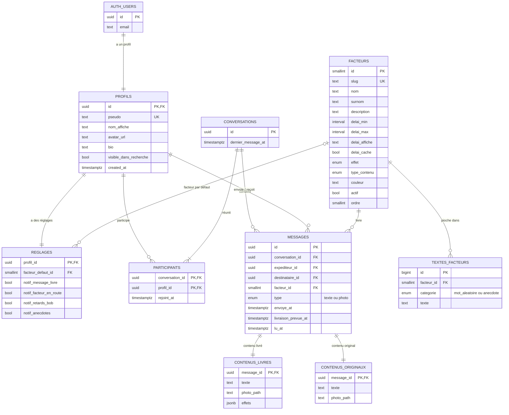

# OOPS Livraison

Messagerie où chaque message est confié à un facteur fictif. Le facteur choisi fixe le délai de livraison… et abîme parfois le message en chemin.

Projet fil-rouge du cours **8WEB101 – Conception et programmation de sites Web**, par Eliot Chataigner et Souhaib Baoussar.

## Tester le site

**Le site est en ligne : [oops.eliotchataigner.fr](https://oops.eliotchataigner.fr)**

Créez un compte, choisissez un facteur par défaut, puis écrivez à quelqu’un. Pour essayer la messagerie à deux, ouvrez un second compte dans une fenêtre de navigation privée : le message part avec le facteur choisi et arrive après son délai.

## Le concept

Une messagerie instantanée qui ne l’est plus : avant d’envoyer un message, on choisit un facteur. Chacun a sa vitesse et ses petites manies. L’identité du site imite un service de suivi de colis (UPS, Postes Canada), avec des facteurs en style cartoon décalé. Le public visé : des étudiants qui veulent pimenter leurs conversations.

| Facteur | Délai | Ce qu’il fait au message |
| --- | --- | --- |
| Eric | 2h00 | ajoute des mots au hasard |
| Lisa | 5 min | perd des mots en chemin |
| Jérôme | 24h00 | rien, livraison nickel |
| Bob | ?????? | rien… quand il finit par arriver (heure cachée) |
| Gwendoline | 30 min | ajoute une de ses anecdotes |
| Peter | 45 min | ne livre que des photos et colle la sienne par-dessus |
| Emma | 1h00 | police et couleur aléatoires pour chaque caractère |

## Fonctionnalités

- Inscription et connexion, avec choix d’un facteur par défaut
- Messagerie : liste des conversations, fil de discussion, choix du facteur à chaque envoi, envoi de photos (Peter)
- Suivi en direct des messages en route : barre de progression, compte à rebours, position du facteur
- Le destinataire ne peut pas lire un message avant sa livraison : c’est la base de données qui le bloque, pas l’interface
- Page « Nos livreurs » : présentation des 7 facteurs et comparatif de leurs effets
- Profil : statistiques (messages envoyés, mots perdus par Lisa…) et facteurs préférés
- Réglages : compte, notifications, facteur par défaut, confidentialité, déconnexion et suppression du compte
  (les préférences de notification sont enregistrées ; l’envoi des notifications n’est pas encore branché)

## Technologies

- HTML, CSS et JavaScript natif (modules ES), sans framework ni outil de build
- Une seule feuille de style, pensée mobile d’abord
- [Supabase](https://supabase.com) : authentification, base PostgreSQL, stockage des photos et temps réel
- Maquettes réalisées sur [Figma](https://www.figma.com/design/d2bTw2D3nlmuUlmUySeF8J/projet-rouge?node-id=0-1&t=AUxGD5QWz97Unvhg-1) 

## Structure

```text
fil-rouge/
├── index.html            Accueil
├── connexion.html
├── inscription.html
├── nos-livreurs.html
├── suivi.html            Suivi des messages
├── messagerie.html
├── profil.html
├── reglages.html
├── styles/
│   └── style.css         feuille de style unique
├── scripts/              modules JavaScript (main.js reconnaît la page et lance son initialisation)
├── images/
└── administrateur/
    ├── ReadMe.md         documentation technique
    ├── maquette.md       inventaire des pages et composants
    ├── schema.sql        base de données Supabase
    └── supprimer_compte.sql  fonction du bouton « Supprimer mon compte »
```

## Modèle de données

Le message est séparé de son contenu : les deux personnes voient le message (et sa progression) dès l’envoi, mais le destinataire ne peut lire le texte qu’une fois le facteur arrivé. Le statut « en route / livré » n’est pas stocké : il se déduit de `livraison_prevue_at` comparé à l’heure actuelle.



### Tables

| Table | Rôle | Qui peut lire |
| --- | --- | --- |
| `facteurs` | les 7 facteurs : délais, effet, type de contenu, couleur | tout le monde, même sans compte |
| `textes_facteurs` | mots d’Eric et anecdotes de Gwendoline | personne (seule la base y pioche) |
| `profils` | profil public, créé automatiquement à l’inscription | utilisateurs connectés |
| `reglages` | facteur par défaut et notifications | le propriétaire |
| `conversations`, `participants` | qui parle avec qui | les participants |
| `messages` | métadonnées : expéditeur, destinataire, facteur, envoi, livraison, lecture | l’expéditeur et le destinataire, même en route |
| `contenus_livres` | texte après passage du facteur et détail des effets (`effets`) | l’expéditeur ; le destinataire après la livraison |
| `contenus_originaux` | texte réellement écrit | l’expéditeur seul |

### Fonctions et vues

| Nom | Type | Rôle |
| --- | --- | --- |
| `envoyer_message` | fonction | vérifie le facteur, tire l’heure d’arrivée, applique l’effet, enregistre le message |
| `ouvrir_conversation` | fonction | retrouve ou crée la conversation avec un autre utilisateur |
| `marquer_conversation_lue` | fonction | marque comme lus les messages livrés |
| `pseudo_disponible` | fonction | vérifie un pseudo à l’inscription |
| `v_messages` | vue | messages prêts à afficher : `est_livre`, `progression`, texte livré |
| `v_suivis` | vue | messages encore en route (page Suivi) |
| `v_conversations` | vue | liste des conversations, aperçu, non-lus, messages en route |
| `v_mes_statistiques`, `v_mes_facteurs_preferes` | vues | chiffres et classement de la page Profil |

L’heure d’arrivée et l’effet du facteur sont calculés par la base au moment de l’envoi : impossible de choisir son délai ou d’éviter Eric. Les photos sont rangées dans deux espaces de stockage : `avatars` (public) et `photos` (privé, lisible par le destinataire seulement après la livraison).

## Auteurs

- Eliot Chataigner
- Souhaib Baoussar
